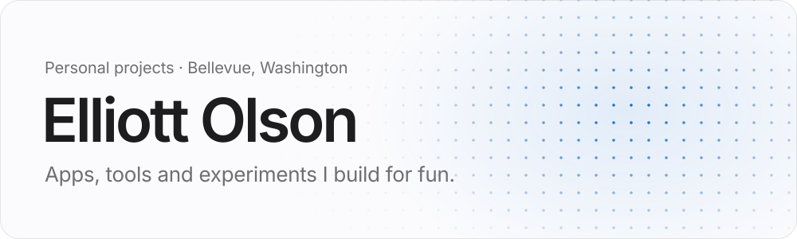

<picture>
  <source media="(prefers-color-scheme: dark)" srcset="assets/header-dark.svg">
  <source media="(prefers-color-scheme: light)" srcset="assets/header-light.svg">
  
</picture>

Hi, I’m Elliott. This is where my side projects live: tools I wanted to exist, ideas I wanted to understand, and the occasional experiment that got out of hand.

By day I’m a software engineer at Amazon. There’s more about that [on my website](https://elliottolson.com).

[Website ↗](https://elliottolson.com) &nbsp;·&nbsp; [LinkedIn ↗](https://www.linkedin.com/in/elliottolson) &nbsp;·&nbsp; [Bluesky ↗](https://bsky.app/profile/elliottolson.com) &nbsp;·&nbsp; [hello@elliottolson.com](mailto:hello@elliottolson.com)

 

### Building now

  <a href="https://github.com/elliottolson/taxman"><picture>
    <source media="(prefers-color-scheme: dark)" srcset="assets/taxman-dark.svg">
    <source media="(prefers-color-scheme: light)" srcset="assets/taxman-light.svg">
    
  </picture></a>

  <a href="https://github.com/elliottolson/elliottolson.com"><picture>
    <source media="(prefers-color-scheme: dark)" srcset="assets/website-dark.svg">
    <source media="(prefers-color-scheme: light)" srcset="assets/website-light.svg">
    
  </picture></a>

 

### Earlier work

**[BowSpleef](https://github.com/elliottolson/bowspleef)** &nbsp;·&nbsp; A Minecraft minigame from 2015, and my first big Java project.

<a href="https://github.com/elliottolson?tab=repositories">All repositories →</a>

